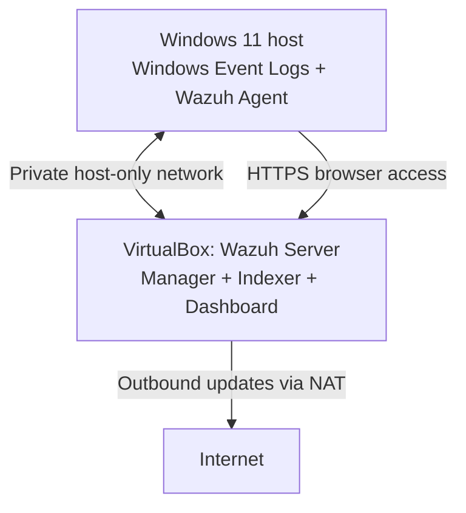

# SOC Log Monitoring and Incident Analysis with Wazuh

**Personal cybersecurity internship portfolio project | November 2026**

A hands-on, single-endpoint SOC lab that uses **Wazuh SIEM 4.14.10**, **Oracle VirtualBox**, **Windows 11**, and **PowerShell** to collect, inspect, correlate, and document security-relevant events. The focus is **evidence-based alert triage**, not claiming that every alert is a cyberattack.

## Project highlights

- Deployed a preconfigured Wazuh server, indexer, and dashboard inside a VirtualBox VM.
- Enrolled a Windows 11 endpoint with a Wazuh agent and verified its **Active** status.
- Examined **five findings** involving Windows application, security, and system events.
- Correlated service-installation and startup-change records into a timeline.
- Verified executable digital signatures using PowerShell.
- Documented investigation limitations and security decisions.

## Lab architecture



The VM used **4 vCPUs, 8 GB RAM, and a 50 GB virtual disk**, with **NAT** and **Host-only** VirtualBox adapters. This is a controlled educational lab, not a production SOC deployment. No production systems or third-party targets were tested.

## Tools and skills

| Tools | Practical skills demonstrated |
| --- | --- |
| Wazuh 4.14.10 | SIEM, alert investigation, event/rule interpretation |
| Windows 11 Event Logs | Authentication, application, and service event analysis |
| PowerShell | Read-only log filtering, event correlation, service inventory |
| Oracle VirtualBox | VM deployment and private lab networking |
| Authenticode | Executable signing and integrity checks |

## Findings summary

| ID | Windows Event / Wazuh Rule | Evidence-based observation | Outcome |
| --- | --- | --- | --- |
| F01 | 1022 / 61020 | .NET Runtime profiling attachment error | Application issue; no confirmed compromise |
| F02 | 5061 / 60104 | Failed cryptographic key operation (`0x80090016`) | Cryptographic audit failure; root cause unconfirmed |
| F03 | 4625 / N/A | Two historical local logon failures; signed ASUS component associated | No evidence establishing brute force or remote compromise |
| F04 | 1001 / 60608 | Snipping Tool Windows Error Reporting diagnostic (`RADAR_PRE_LEAK_64`) | Potential application memory issue; unconfirmed |
| F05 | 7040 and 7045 / 61104 (7040) | Repeated McAfee service installation and startup-type changes | No confirmed malicious change; further context needed |

**Evidence boundary:** The two 4625 authentication events predated agent enrollment and were investigated locally with PowerShell. They were **not** shown as historical Wazuh alerts. A Wazuh rule level or Windows audit failure is **not** by itself proof of malicious activity.

See [Case studies and timeline](docs/CASE_STUDIES.md) for more details.

## Selected correlation timeline (Finding F05)

| Local time, 20 Nov 2026 | Windows event | Observation |
| --- | --- | --- |
| 17:07:59 | 7045 | McAfee-related service installation recorded |
| 17:08:37 | 7040 | Startup type changed from demand start to disabled |
| 17:09:55 | 7045 | Second installation event for the same service name |
| 17:10:06 | 7040 | Startup type again changed to disabled |

The referenced executable had a **Valid** Authenticode signature from **McAfee, LLC**. It was not possible to determine who initiated the changes. Microsoft Defender was separately observed to be **On / Active**. No containment action was justified by the captured evidence.

## Repository contents

```text
SOC-Log-Monitoring-Wazuh/
├── README.md                  # Project overview
├── docs/
│   ├── LAB_SETUP.md           # Lab design and reproducible checks
│   ├── CASE_STUDIES.md        # Findings and investigation timeline
│   └── PRIVACY_CHECKLIST.md   # Review before publishing evidence
├── evidence/
│   └── README.md              # Add only redacted screenshots here
├── reports/
│   └── README.md              # Add redacted public report here later
└── .gitignore
```

## Evidence and report

The original investigation includes Wazuh dashboard screenshots, expanded alert details, and PowerShell outputs. **Screenshots and the full Word report are intentionally excluded from this public starter repository** because they may contain local account names, hostnames, SIDs, file paths, or other personal details. Only sanitized copies should be published after completing the [privacy checklist](docs/PRIVACY_CHECKLIST.md).

## How to reproduce the learning lab

See [Lab setup and validation](docs/LAB_SETUP.md). Always use systems you own or are authorized to administer.

## What I learned

A security alert is a **lead for investigation**, not proof of an incident. I practiced determining event context, correlating related Windows logs, checking executables' digital signatures, and making cautious response decisions supported by available evidence.

## Documentation references

- [Wazuh VM deployment](https://documentation.wazuh.com/current/deployment-options/virtual-machine/virtual-machine.html)
- [Wazuh Windows agent installation](https://documentation.wazuh.com/current/installation-guide/wazuh-agent/wazuh-agent-package-windows.html)
- [Wazuh Threat Hunting](https://documentation.wazuh.com/current/getting-started/use-cases/threat-hunting.html)
- [Microsoft Get-WinEvent](https://learn.microsoft.com/en-us/powershell/module/microsoft.powershell.diagnostics/get-winevent)
- [Microsoft Get-AuthenticodeSignature](https://learn.microsoft.com/en-us/powershell/module/microsoft.powershell.security/get-authenticodesignature)
